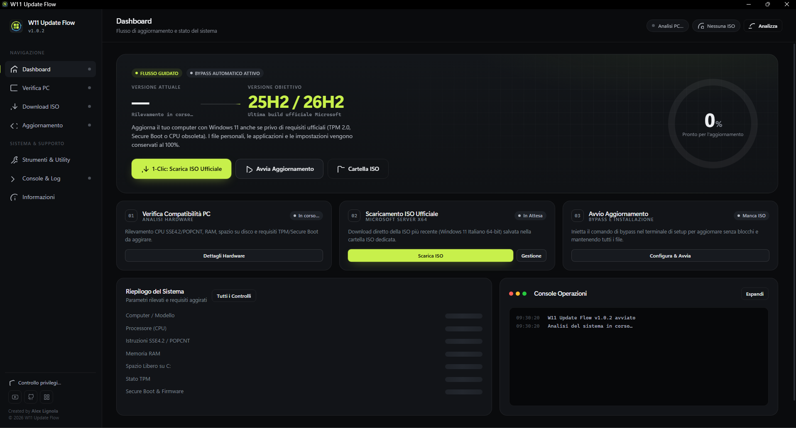

# 📘 Guida all'Utilizzo — W11 Update Flow

Questa guida spiega passo per passo come usare **W11 Update Flow** per aggiornare Windows 11 (o passare da Windows 10 a Windows 11) su un PC con hardware non ufficialmente supportato, **senza perdere file, programmi e impostazioni**.

<p align="center">
  
</p>

---

## 📑 Indice

1. [Prima di iniziare](#1-prima-di-iniziare)
2. [Avvio dell'applicazione](#2-avvio-dellapplicazione)
3. [Panoramica dell'interfaccia](#3-panoramica-dellinterfaccia)
4. [Passo 1 — Verifica compatibilità del PC](#4-passo-1--verifica-compatibilità-del-pc)
5. [Passo 2 — Download della ISO ufficiale](#5-passo-2--download-della-iso-ufficiale)
6. [Aggiornamento della ISO già scaricata](#6-aggiornamento-della-iso-già-scaricata)
7. [Passo 3 — Avvio dell'aggiornamento](#7-passo-3--avvio-dellaggiornamento)
8. [Strumenti & Utility](#8-strumenti--utility)
9. [Console & Registri](#9-console--registri)
10. [Dopo l'aggiornamento](#10-dopo-laggiornamento)
11. [Risoluzione dei problemi (FAQ)](#11-risoluzione-dei-problemi-faq)

---

## 1. Prima di iniziare

Prima di avviare la procedura assicurati che:

- ✅ Il PC sia **collegato alla corrente** (per i portatili, alimentatore inserito).
- ✅ Sul disco **C:** ci siano almeno **20–30 GB liberi**.
- ✅ La connessione Internet sia stabile (la ISO pesa circa **5–7 GB**).
- ✅ Il processore supporti le istruzioni **SSE4.2** e **POPCNT** (l'app lo verifica automaticamente: senza di esse Windows 11 24H2+ **non può** avviarsi).
- ✅ Se è attivo **BitLocker**, tieni a portata di mano la chiave di ripristino oppure sospendilo temporaneamente.
- 💾 Hai un **backup** dei documenti importanti (consigliato, anche se la procedura mantiene tutti i file).

---

## 2. Avvio dell'applicazione

### Versione eseguibile
Fai doppio clic su **`W11 Update Flow.exe`**. Windows chiederà la conferma UAC: l'app richiede i **privilegi di amministratore** per modificare il registro e lanciare il setup.

### Versione da sorgenti
```powershell
python main.py
```
Se non avviata come amministratore, l'app richiede automaticamente l'elevazione.

L'interfaccia si apre in una finestra dedicata (Edge/Chrome in modalità applicazione). Chiudendo la finestra l'applicazione termina.

---

## 3. Panoramica dell'interfaccia

| Sezione | A cosa serve |
| :--- | :--- |
| **Dashboard** | Riepilogo stato PC, anello di prontezza, flusso in 3 passaggi e console eventi. |
| **Compatibilità** | Analisi dettagliata di CPU, RAM, disco, TPM, Secure Boot, BitLocker, riavvii in sospeso. |
| **Download ISO** | Scaricamento della ISO ufficiale, pausa/ripresa, elenco ISO disponibili e verifica aggiornamenti. |
| **Aggiornamento** | Scelta della modalità e del metodo di bypass, anteprima comando e avvio del setup. |
| **Strumenti** | Punto di ripristino, rimozione watermark, estensione rollback, SHA-256, log di setup. |
| **Console** | Registro completo in tempo reale, copiabile e salvato su file. |
| **Informazioni** | Versione, autore, canali ufficiali e copyright. |

Nella barra superiore trovi due indicatori rapidi: **stato hardware** e **ISO selezionata**.

---

## 4. Passo 1 — Verifica compatibilità del PC

All'avvio l'app esegue automaticamente la scansione del sistema. Puoi ripeterla in qualsiasi momento con **Ricontrolla** nella sezione *Compatibilità*.

Ogni requisito viene marcato con uno stato:

| Etichetta | Significato |
| :--- | :--- |
| 🟢 **SODDISFATTO** | Requisito rispettato. |
| 🟣 **AGGIRATO CON BYPASS** | Requisito non rispettato ma superato automaticamente dall'app (es. TPM 2.0, Secure Boot, CPU non in lista). |
| 🟡 **ATTENZIONE** | Non blocca, ma va valutato (es. BitLocker attivo, riavvio in sospeso). |
| 🔴 **NON IDONEO** | Requisito bloccante (es. CPU senza SSE4.2/POPCNT, spazio insufficiente). Va risolto prima di procedere. |

---

## 5. Passo 2 — Download della ISO ufficiale

1. Vai in **Download ISO** (oppure usa il pulsante **1-Clic: Scarica ISO Ufficiale** nella Dashboard).
2. Premi **Avvia Scaricamento**.
3. L'app si collega ai server Microsoft, ottiene il link ufficiale di **Windows 11 64-bit in Italiano** e scarica la ISO nella cartella **`ISO/`** accanto all'applicazione.

Durante il download puoi:
- ⏸️ **Pausa** e riprendere in seguito (anche dopo aver chiuso l'app: il file parziale `.part` viene riconosciuto).
- ❌ **Annulla** (il file parziale viene eliminato).

Al termine la ISO appare nell'elenco **Immagini ISO Disponibili** e viene selezionata automaticamente.

> [!TIP]
> Hai già una ISO di Windows 11? Usa **Seleziona ISO esterna…** per sceglierla da qualsiasi percorso, oppure copiala nella cartella `ISO/` (pulsante **Apri Cartella ISO**).

---

## 6. Aggiornamento della ISO già scaricata

Se nella cartella `ISO/` è **già presente** una ISO, premendo di nuovo **Scarica ISO** l'app **non riscarica** subito il file, ma:

1. Contatta il sito Microsoft e recupera le informazioni sull'ultima ISO disponibile.
2. La confronta con la ISO presente nella cartella `ISO/`:
   - versione di rilascio (es. **24H2 → 25H2**);
   - numero di build (se presente nel nome del file);
   - nome del file (es. revisioni `…x64v2.iso`);
   - dimensione, se il nome del file è identico (Microsoft a volte ripubblica la stessa ISO aggiornata).
3. Mostra l'esito:
   - ✅ **ISO già aggiornata** → compare un messaggio di conferma, nessun download.
   - 🔔 **Versione più recente disponibile** → si apre una finestra di confronto con *ISO attuale* e *Nuova ISO* (versione, nome file, dimensione e data).

Nella finestra puoi scegliere:

| Pulsante | Azione |
| :--- | :--- |
| **Mantieni l'attuale** | Chiude la finestra, nessuna modifica. |
| **Scarica e sostituisci** | Scarica la nuova ISO e, **al termine del download**, elimina la vecchia ISO dalla cartella `ISO/`. La nuova ISO viene selezionata automaticamente. |

> [!NOTE]
> La vecchia ISO viene eliminata **solo dopo** che la nuova è stata scaricata completamente: se il download si interrompe o viene annullato, la ISO precedente resta disponibile. Se la vecchia ISO è montata come unità virtuale, smontala prima (strumento **Smonta Immagine ISO**), altrimenti non potrà essere eliminata.

---

## 7. Passo 3 — Avvio dell'aggiornamento

1. Vai nella sezione **Aggiornamento** e controlla che la ISO selezionata sia quella corretta.
2. Scegli la **Modalità di aggiornamento**:
   - **Automatica** – accetta l'EULA ed esegue l'aggiornamento mantenendo file e app (`/auto upgrade /EULA accept`).
   - **Guidata** – mostra a schermo la procedura di setup passo-passo.
   - **Silenziosa** – esecuzione in background con riavvio (`/quiet`).
3. Scegli il **Metodo di Bypass**:
   - **Stringa Setup Server (Consigliato)** – `setup.exe /product server /compat IgnoreWarning /MigrateDrivers All /DynamicUpdate Disable`.
   - **Neutralizzazione Appraiser** – copia locale della ISO con sostituzione di `appraiserres.dll` (alternativa se il primo metodo fallisce).
4. Opzioni consigliate:
   - ☑️ **Crea Punto di Ripristino del Sistema** prima di iniziare.
   - ☑️ **Rimuovi Avviso Watermark sul Desktop** dopo l'aggiornamento.
5. Premi **Avvia Procedura di Aggiornamento**, conferma le tre spunte nella finestra di riepilogo e clicca **Conferma e Avvia Setup**.

La **timeline** mostra in tempo reale ogni fase: chiavi di registro, montaggio ISO, preparazione e lancio del setup. Il PC si riavvierà più volte: **non spegnerlo** durante l'installazione.

---

## 8. Strumenti & Utility

| Strumento | Descrizione |
| :--- | :--- |
| **Verifica Integrità SHA-256** | Calcola l'hash della ISO selezionata per controllarne l'integrità. |
| **Crea Punto di Ripristino** | Crea subito un punto di ripristino manuale del sistema. |
| **Rimuovi Watermark** | Elimina l'avviso desktop "Requisiti di sistema non soddisfatti". |
| **Estendi Rollback a 60 Giorni** | Porta da 10 a 60 giorni il tempo per tornare alla versione precedente (`DISM /Set-OSUninstallWindow /Value:60`). |
| **Pulizia Disco di Windows** | Avvia `cleanmgr.exe` per liberare spazio su C:. |
| **Log di Windows Setup (Panther)** | Apre la cartella `$WINDOWS.~BT\Sources\Panther` con i log di Windows Setup. |
| **Pulisci File Temporanei W11UF** | Elimina file `.part` e cartelle di setup temporanee create dall'app. |
| **Smonta Immagine ISO** | Smonta l'unità virtuale creata durante l'aggiornamento. |
| **Opzioni di Ripristino Windows** | Apre le impostazioni di ripristino per un eventuale rollback. |

---

## 9. Console & Registri

La sezione **Console** mostra tutti gli eventi (info, avvisi ed errori) con orario. Puoi:
- **Copiare** il registro negli appunti (utile per chiedere assistenza);
- **Aprire il file di log** salvato su disco.

Un pallino giallo sulla voce di menu segnala nuovi avvisi o errori.

---

## 10. Dopo l'aggiornamento

- Verifica la nuova versione con `Win + R` → `winver`.
- Se necessario, usa **Rimuovi Watermark** dalla sezione Strumenti.
- Entro **10 giorni** (o **60** se hai esteso il rollback) puoi tornare alla versione precedente da *Impostazioni → Sistema → Ripristino*.
- Puoi eliminare le ISO non più necessarie dalla cartella `ISO/` per liberare spazio.

---

## 11. Risoluzione dei problemi (FAQ)

**❓ Il download si blocca con l'errore "715-123130".**
Microsoft ha temporaneamente bloccato le richieste dal tuo indirizzo IP. Attendi qualche ora, cambia rete o disattiva eventuali VPN/proxy.

**❓ "Impossibile verificare gli aggiornamenti".**
Il sito Microsoft non è raggiungibile o ha rifiutato la richiesta. La ISO già presente resta utilizzabile: riprova più tardi.

**❓ La vecchia ISO non è stata eliminata dopo il download della nuova.**
Probabilmente era montata o in uso. Usa **Smonta Immagine ISO** e cancellala manualmente dalla cartella `ISO/`.

**❓ Il setup segnala "Questo PC non soddisfa i requisiti".**
Riprova con il metodo di bypass **Neutralizzazione Appraiser**, oppure verifica che la CPU supporti SSE4.2/POPCNT.

**❓ Il PC si riavvia chiedendo la chiave di BitLocker.**
Inserisci la chiave di ripristino (disponibile su https://account.microsoft.com/devices/recoverykey). Per evitarlo, sospendi BitLocker prima dell'aggiornamento.

**❓ L'aggiornamento non va a buon fine e torna alla versione precedente.**
Apri **Log di Windows Setup (Panther)** e controlla `setuperr.log`; copia la console dell'app e chiedi supporto sul canale YouTube.

---

## 📄 Licenza & Esclusione di Responsabilità

Questo progetto è distribuito secondo i termini della licenza **GNU General Public License v3.0** — vedi il file [LICENSE](LICENSE).

> [!CAUTION]
> L'utilizzo dell'applicazione avviene a esclusivo rischio e pericolo dell'utente. Consulta la sezione [Esclusione di Responsabilità & Clausole di Salvaguardia](README.md#-esclusione-di-responsabilit--clausole-di-salvaguardia-disclaimer) nel file `README.md` per le clausole complete e vincolanti di limitazione di responsabilità e l'obbligo di backup preventivo dei dati.

<p align="center">
  Sviluppato da <b>Alex Lignola</b> · <a href="https://www.youtube.com/@AngoloInformatico">L'Angolo Informatico</a><br>
  <a href="README.md">⬅ Torna al README</a>
</p>
